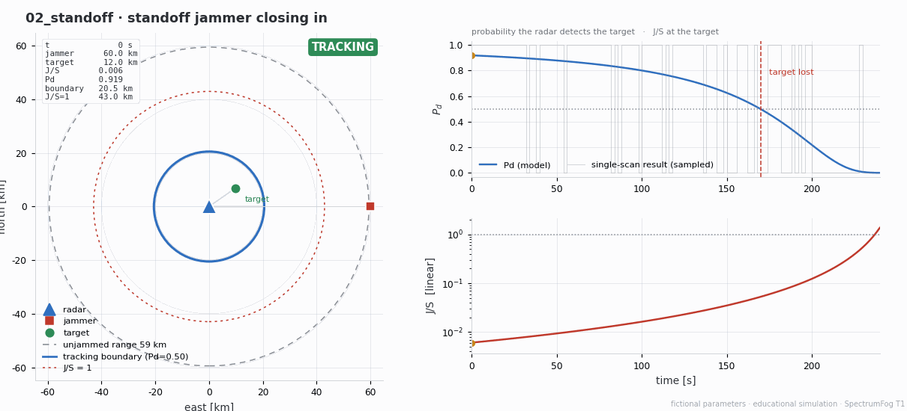
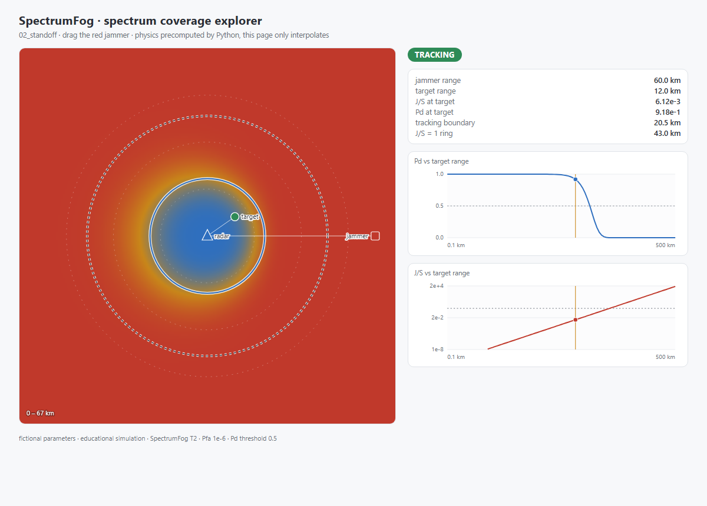
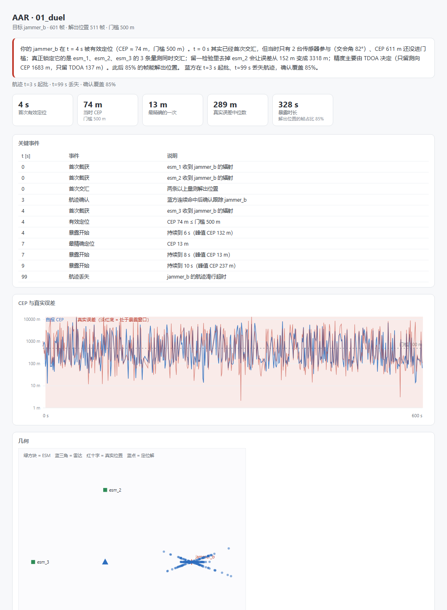

# SpectrumFog / 频谱迷雾

[](https://github.com/haohaohao-cell/spectrumfog/actions/workflows/ci.yml)
[](https://haohaohao-cell.github.io/spectrumfog/)

**在线试用：[haohaohao-cell.github.io/spectrumfog](https://haohaohao-cell.github.io/spectrumfog/)** —— 拖动干扰机，看雷达覆盖怎么塌。纯静态，无后端。

**一个部分可观测的电磁对抗仿真平台**：双方都只能看到被干扰污染、被聚合过的频谱态势，
必须靠定位与识别反推对手的辐射源在哪、是什么。

不是"算杀伤"的兵棋，是"算认知"的环境。



> `spectrumfog sim scenarios/02_standoff.yaml --gif` 直接生成：干扰机从 60 km 压到 4 km，
> 雷达的跟踪边界从 20.5 km 收缩到 5.3 km，12 km 处的目标在 t = 170 s 丢失。
> 右上曲线是模型概率 Pd，灰色阶梯是单次照射的抽样结果。

## 一条命令跑起来

```bash
python -m venv .venv
. .venv/bin/activate          # Windows: .venv\Scripts\activate
pip install -e .

spectrumfog sim scenarios/02_standoff.yaml --gif   # 跑仿真 → replay.jsonl → GIF
spectrumfog run scenarios/01_duel.yaml             # 静态曲线：烧穿 / Pd–距离 / J/S–距离
```

如果 `spectrumfog` 不在 PATH 里（Windows 上 pip 的 `Scripts/` 目录常常不在），
等价写法是 `python -m spectrumfog ...`。

| 命令 | 产出 |
|---|---|
| `spectrumfog sim <yaml>` | `out/<name>.jsonl`（一行一事件的 replay）+ 终端摘要 |
| `spectrumfog sim <yaml> --gif` | 再加一段俯视动画 `out/<name>.gif` |
| `spectrumfog animate <jsonl> -o x.gif` | 只读 replay 重出动画（viz 不碰引擎） |
| `spectrumfog run <yaml>` | 三张静态图 + 链路指标 |
| `spectrumfog export-web <yaml> -o data.json` | 前端数据包（T2 用，见下） |
| `spectrumfog aar <jsonl>` | 复盘报告：时间线 + 暴露时长 + 归因（单页 HTML） |

## 当前状态

**T2 — Web 交互已上线**（106 项 Python 单测 + 16 项前端单测，CI 全绿）。
在线页面：[haohaohao-cell.github.io/spectrumfog](https://haohaohao-cell.github.io/spectrumfog/)

| 部分 | 状态 |
|---|---|
| 雷达方程 / J·S / 烧穿距离 / Pd（Swerling I）/ 检测距离 | ✅ |
| 自由空间传播 / 链路预算 / Eb·N0 / 抗干扰余量 | ✅ |
| 想定 YAML（pydantic 校验 + 单位归一化 + 航路点） | ✅ |
| 固定步长时钟 + 确定性主循环 + seeded RNG | ✅ |
| replay JSONL：一行一事件、逐字节可复现 | ✅ |
| 俯视动画（包围圈收缩 / Pd·J/S 时间曲线） | ✅ |
| 观测（AOA/TOA/功率测量）+ 融合定位 + 虚假目标 | ✅ T3a |
| AAR 复盘（时间线 · 暴露时长 · 留一法归因 · HTML 报告） | ✅ T3a |
| Web 交互（拖动干扰机 → 热力图与曲线） | ✅ 线上已部署 |

## 两个反直觉的结果（免得你以为算错了）

**1. 烧穿 ≠ 能检测。** `01_duel`（150 kW / 35 dBi 雷达，90 W 干扰机在 30 km）里，
J/S = 1 的烧穿半径是 3.24 km，但干扰下真正还能维持 Pd = 0.5 的距离只有 0.75 km——差了 4 倍多。
因为 J/S = 1 只是把信噪比砍掉 3 dB，而这里的 Swerling I 闭式要 Pd = 0.5 得约 20 dB。
**"目标在烧穿圈内"不等于"雷达看得见它"。**

**2. 1 W 干扰机能压制 150 kW 雷达。** `02_standoff` 里，1 W 干扰机在 60 km、
目标在 12 km。因为 v1 没有处理增益（脉压、相干积累、MTI）：
100 MHz 上摊开的 1 W 落进 2 MHz 接收机只剩 20 mW，而 12 km 处的回波本身只有 −67 dBm，
噪声底是 −108 dBm。若补上 20 dB 处理增益，烧穿距离会涨约 10 倍——所以这些"过小的干扰功率"
是模型缺口的产物，不是仿真结果。

这两条都是 [docs/design.md](docs/design.md) §5–§6 里写明的取舍，
完整缺口清单在 [docs/physics.md](docs/physics.md) §7（无处理增益、无多径地形、无航迹状态机）。

## Web 交互（T2）

拖动干扰机，覆盖热力图、跟踪边界和两条曲线实时跟着变；**没有后端**。
物理仍然只有 Python 这一份：`export-web` 把 Pd/J-S 编译成 (Rt, Rj) 查表，
网页只做插值和画图。

```bash
spectrumfog export-web scenarios/02_standoff.yaml -o viz/web/public/data.json
cd viz/web && npm install && npm run dev      # http://localhost:5173
npm run build                                 # dist/ 纯静态，可丢 GitHub Pages
```

数据包格式与"为什么前端不算物理"写在 [docs/web.md](docs/web.md)。



*初始状态：干扰机在 60 km，12 km 处的目标仍被跟踪（Pd 0.92），跟踪边界 20.5 km。
把红色方块往雷达方向拖，边界和蓝色区域会一起收缩。*

## AAR 复盘（T3a）

`replay.jsonl` 进，单页 HTML 出：关键事件时间线、暴露时长、定位误差归因。
结论句是自动生成的，每个数字都能由日志行复算：

> 你的 jammer_b 在 t = 4 s 被有效定位（CEP ≈ 74 m，门槛 500 m）。
> t = 0 s 其实已经首次交汇，但当时只有 2 台传感器参与（交会角 82°）、CEP 611 m 还没进门槛；
> 真正锁定它的是 esm_1、esm_2、esm_3 的 3 条量测同时交汇；
> 留一检验里去掉 esm_2 会让误差从 152 m 变成 3318 m；
> 精度主要由 TDOA 决定（只留测向 CEP 1683 m，只留 TDOA 137 m）。

```bash
spectrumfog sim scenarios/01_duel.yaml --out out     # 出 replay
spectrumfog aar out/01_duel.jsonl                    # 出 out/01_duel_aar.html
```

两份想定都能复盘，结论完全不同：

| 想定 | 首次有效定位 | 暴露时长 | 最精确 | 为什么会这样 |
|---|---|---|---|---|
| `01_duel`（固定站位） | 4 s | 328 s | 13 m | 三站同帧交汇，精度由 TDOA 撑起（只留测向 CEP 1683 m） |
| `02_standoff`（干扰机 60→4 km） | 44 s | 90 s | 11 m | 前 40 秒只有零星截获，凑不齐同帧两站；越近越准 |

`02_standoff` 前 44 秒没被有效定位，不是模型坏了：1 W 的干扰机在 60 km 处 SNR 只有 11，
**收得到、定不准**；等它压进 20 km 以内，同帧两站交汇才有意义，CEP 从 461 m 收敛到 11 m。
反过来，降功率确实更隐蔽——`01_duel` 里把 90 W 降到 9 W，对方就再也定不进门槛
（最好 943 m > 500 m），代价是压制效果也弱了。

"原因是 X" 不是形容词：**留一法**逐台去掉传感器重解一次，外加"只留测向 / 只留 TDOA"
两组对照，都是同一套最小二乘，所以归因结论和定位结论不可能不一致。



## 怎么读这份代码

```
src/spectrumfog/
  units.py        SI 常量 + 单位换算（dB/km/MHz 只活在边界上）
  physics/        radar.py · propagation.py · comms.py —— 纯 numpy，无状态
  model/          scenario.py · platform.py · emitter.py · sensor.py —— pydantic
  engine/         clock.py（固定步长）· sim.py（主循环）
  replay.py       JSONL 读写；帧聚合
  cli.py          run / sim / animate / export-web / aar
viz/static/
  plot.py         matplotlib 静态图
  animate.py      俯视动画（只读 replay，不回写）
scenarios/
  01_duel.yaml        T0：单雷达 vs 单干扰机 + 三部 ESM（自屏蔽，静态）
  02_standoff.yaml    T1：站距干扰 + 移动干扰机 + 待机目标（动画）
tests/              136 项：物理、想定、时钟、回放、确定性、动画、融合、AAR、Web 数据包、CLI
viz/web/src/        16 项前端单测（查表解码、插值、首屏渲染）
docs/               physics.md（公式与假设）· design.md（建模取舍）· scenario.md（YAML schema）
                    metrics.md（指标定义）· web.md（前端数据包）· launch.md（发布文案）
```

三条硬约束（[PROJECT.md](PROJECT.md) §2，改之前先想清楚）：

1. **确定性优先**：固定步长 + seeded RNG + 事件日志；同一 seed 的 replay 逐字节相同。
2. **引擎与表现分离**：`spectrumfog` 内核不 import 任何 UI 库；`viz` 只读 replay。
3. **一个内核，三个面**：CLI / Web / Gym 共用同一份物理，不许各写一套。

内部一律 SI（W / m / Hz / s / rad）；dB、km、MHz 只允许出现在 YAML 输入和终端输出。

## 文档地图

| 想知道什么 | 看哪 |
|---|---|
| 公式、单位、假设、**已知缺口** | [docs/physics.md](docs/physics.md) |
| **为什么这么设计**（取舍、被否决的方案） | [docs/design.md](docs/design.md) |
| 想定 YAML 怎么写 | [docs/scenario.md](docs/scenario.md) |
| 指标口径（Pd / CEP / 暴露时长…） | [docs/metrics.md](docs/metrics.md) |
| 网页的数据包怎么来的 | [docs/web.md](docs/web.md) |
| 路线图与验收标准 | [PROJECT.md](PROJECT.md) |

## 合规声明

- 仅使用公开教科书物理公式（雷达方程、Friis、Swerling I）与**虚构参数**；
  不包含任何真实装备性能数据、番号或部署信息。
- 定位为 educational / research simulation，非作战软件，不提供战术建议。
- 命名与文案避免"作战/打击/杀伤"等表述，统一用 simulation / analysis。

## 许可

- **代码**（`src/`、`viz/`、`tests/`）：[Apache-2.0](LICENSE)，版权 2026 郝仁昱
- **文档与想定**（`docs/`、`scenarios/`、`README.md`）：[CC BY 4.0](LICENSE-docs)

引用信息见 [CITATION.cff](CITATION.cff)。
